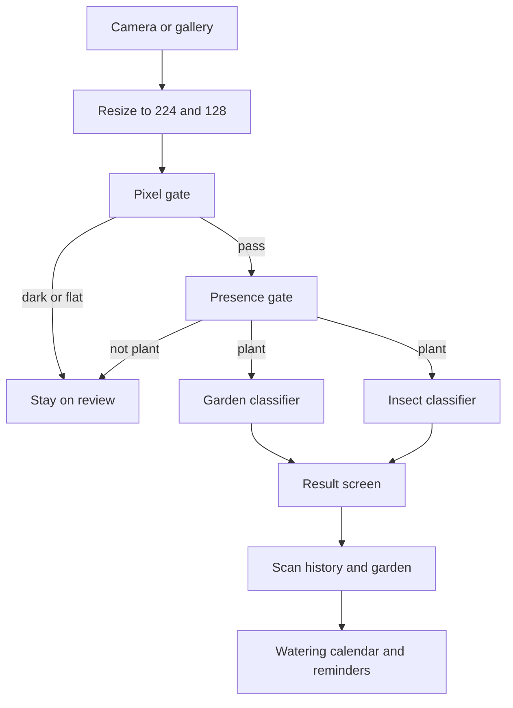
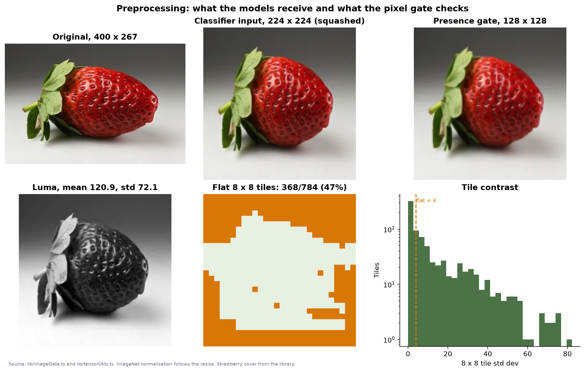
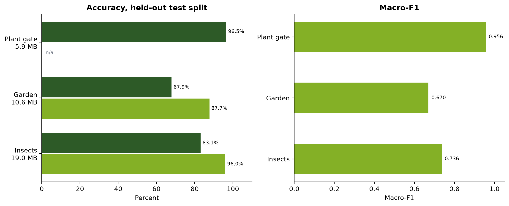
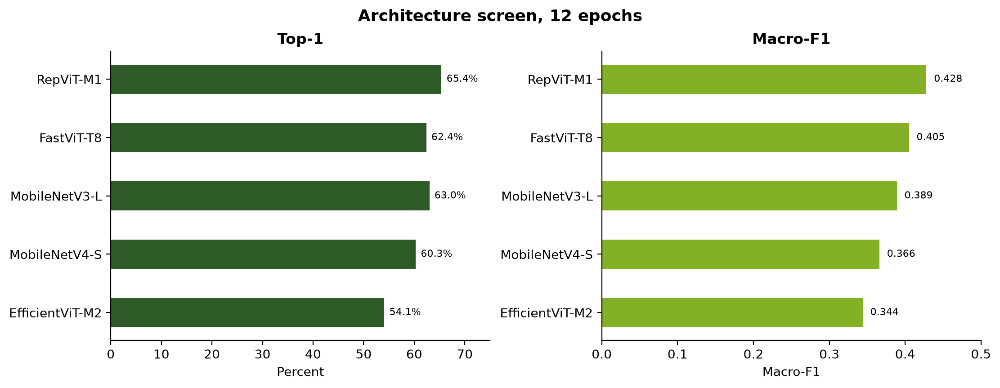
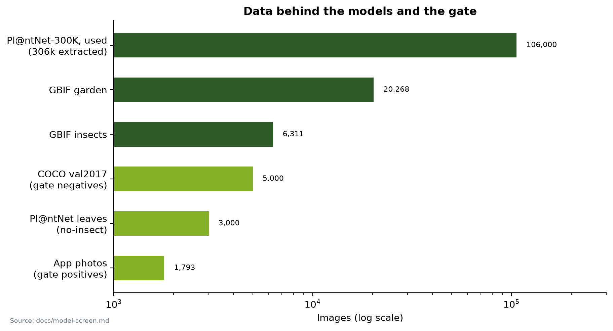

# FloraLens

I built FloraLens to identify the plants in a garden without sending the photo to a server. It is an Android app: point the camera at a leaf or pick a photo, and two on-device classifiers return a species and an insect check. A 118-class garden model and a 23-class insect model run through ONNX Runtime, behind a pixel gate and a plant-presence gate that reject blank frames and non-plants before either classifier sees them. Scans, the garden and watering reminders stay in the app's private storage.

<table><tr>
<td align="center"></td>
<td align="center"><video src="https://github.com/user-attachments/assets/7717cbac-3df7-45a6-aea6-779f5f951564" controls muted playsinline aria-label="26-second screen recording of FloraLens"></video></td>
<td align="center"></td>
</tr></table>

_Home, the 26-second demo recorded on a Pixel 8a, and a Hydrangea result at 97%. The screenshots use the seeded demo garden, which is built from public library covers, not personal photos._

## Contents

- [What it does](#what-it-does)
- [What stays on the device](#what-stays-on-the-device)
- [Requirements](#requirements)
- [Install and run](#install-and-run)
- [First run](#first-run)
- [Usage](#usage)
- [How it works](#how-it-works)
- [Preprocessing](#preprocessing)
- [Models and results](#models-and-results)
- [Dataset and training](#dataset-and-training)
- [Reproduce the models](#reproduce-the-models)
- [Configuration](#configuration)
- [Project layout](#project-layout)
- [Limits](#limits)
- [Troubleshooting](#troubleshooting)
- [Docs](#docs)
- [Stack](#stack)

## What it does

- Identifies 118 garden, houseplant, herb, fruit and vegetable species. The result screen shows the top five candidates and marks the scan "not sure" when the best match is below 50%.
- Rejects a frame before classification when it is too dark, too flat, or contains no plant. The presence gate rejects at a not-plant probability of 0.85, so a laptop screen does not become a confident cabbage.
- Checks the same leaf for 22 garden insects plus a `no_insect` class. Beneficial insects are reported as beneficial, not as pests.
- Saves scans to a garden and shows a month calendar of watering days. Each plant has a 3, 7, 14 or 30-day interval, and a local notification fires at 09:00 on its due date.
- Uses the Android photo permission on 14 and newer. Users can grant access to only selected photos; the in-app gallery lists only the assets the app is allowed to read.

## What stays on the device

The app has no account, no backend and no analytics. A scan record and its JPEG are written to the app sandbox:

```text
files/scan_<id>.jpg                       saved scan photo
files/mmkv/floralens-storage              MMKV store: scan history, garden, settings
```

The scan JPEG is copied into private storage when the scan is saved. Deleting the scan removes the JPEG if no garden entry references it. Uninstalling the app deletes the history and the photos, because Android removes the sandbox.

Permissions are deliberately narrow. The manifest declares `CAMERA`, `POST_NOTIFICATIONS`, `READ_MEDIA_IMAGES`, `READ_MEDIA_VISUAL_USER_SELECTED`, and `READ_EXTERNAL_STORAGE` with `maxSdkVersion=32` for older Android. Microphone, overlay, `WRITE_EXTERNAL_STORAGE`, `READ_MEDIA_VIDEO` and `READ_MEDIA_AUDIO` are blocked in `app.json`. iOS is not a supported target in this repo.

The only optional network request is the full-resolution reference photo pack. It is disabled unless `EXPO_PUBLIC_PLANT_PACK_URL` is set at build time; this build leaves it unset, so the Settings section is hidden. The three ONNX models ship as assets and do not download at runtime. Library covers come from Wikipedia and Wikimedia Commons, mostly under CC BY-SA, and are credited in Settings.

## Requirements

- Android 7.0 (API 24) or newer, target SDK 36. I tested the release on a Pixel 8a running Android 17.
- Node, a JDK, and the Android SDK for the app build.
- The three model files in `assets/models/`, which are not committed.
- Python 3.11 or 3.12 and [uv](https://docs.astral.sh/uv/) for the ML pipeline.
- Training used an RTX 5070 for 12 hours. Inference is CPU-side through ONNX Runtime; the app does not need a GPU.

The arm64 release APK is 116 MB. The three ONNX files account for about 35.5 MB: 5.9 MB for the gate, 10.6 MB for the garden model and 19.0 MB for the insect model.

## Install and run

### App

```bash
git clone https://github.com/abderrahmenex86/FloraLens
cd FloraLens
npm install
npx expo prebuild --platform android
npx expo run:android
```

`npm install` runs two postinstall patches. `scripts/patch-onnx-gradle.js` removes the Gradle 8 classpath from `onnxruntime-react-native` so it builds under Gradle 9. `scripts/patch-react-native-css.js` adds the `AssetRegistry` forwarder that NativeWind's React Native shim drops.

Copy the exported models into the app before scanning:

```text
ml/exports/plant_gate/plant_gate.onnx  ->  assets/models/plant_gate.onnx
ml/exports/garden/model.onnx          ->  assets/models/plant_model.onnx
ml/exports/insects/model.onnx         ->  assets/models/insect_model.onnx
```

Without them the Home screen loads, but pressing Analyze fails because the inference sessions cannot open.

A release build for an arm64 phone:

```bash
cd android
./gradlew assembleRelease -PreactNativeArchitectures=arm64-v8a \
  --no-parallel --max-workers=2 \
  -Dorg.gradle.jvmargs="-Xmx3g -XX:MaxMetaspaceSize=1g"
```

The release is signed with the local debug keystore. Replace it before publishing.

### ML pipeline

```bash
uv sync --project ml --extra train --extra eval --extra dedupe --extra dev
uv run --project ml pytest -q ml/tests
uv run --project ml floralens --help
```

The tests cover manifests, cleaning, selection, splitting, taxonomy and the rule engine. The last run finished with `16 passed in 0.50s`. Datasets and checkpoints are not in git; the pipeline expects them under `data/`, `ml/data/`, `ml/runs/` and `ml/exports/`.

## First run

The first launch opens on Home with no account and no setup wizard. Camera and photo prompts appear when you open the Scan tab or the gallery. The notification prompt appears only when you turn on watering reminders. The first analysis loads the ONNX sessions; later scans reuse them.

The gallery is its own screen, not the system photo picker. On Android 14 and newer, choose **Select photos** in the permission dialog to grant a subset. The app can then see only those assets. If the gallery is empty, tap **Select photos** on the picker screen to change the selection.

## Usage

1. Open **Scan** and take a photo or choose one from the gallery.
2. Review the frame and press **Analyze**. A dark, flat or plant-free frame stays on the review screen with a toast.
3. On the result screen, read the top match, the confidence, the care note and the alternative species. Press the bookmark to save the scan to the garden.
4. Open **Garden** to see the month calendar. Days with plants due are marked. Tap a day to list the plants due that day, then use the droplet to mark one watered or tap the status text to change its interval.
5. Open **Settings** to turn watering reminders on or off. Reminders are scheduled locally at 09:00.


## How it works



The camera path in `app/camera.tsx` makes two resized JPEGs, one at 224×224 and one at 128×128. The 224 frame goes to `mlPipeline.checkPhoto`, which computes luma and flat 8×8 tiles in `lib/imageGate.ts`. The 128 frame goes to `mlPipeline.checkPlantPresence`, a two-class MobileNetV3-Small that rejects frames when the plant probability is below 0.15.

If both gates pass, `mlPipeline.analyzePlant` and `analyzePest` run in parallel. Both models take a 224×224 ImageNet-normalised tensor. `processClassification` softmaxes the logits, sorts them and keeps the top five. The plant screen marks a result uncertain below 0.5 or a top-1/top-2 margin below 0.12. The insect treatment appears only when the insect score is at least 0.7. The result screen writes the scan through `lib/storage.ts`; the garden and watering state live in MMKV, and `lib/watering.ts` rebuilds notifications after watering, interval changes, deletions, app start and foreground returns.

The photo picker in `app/photo-picker.tsx` queries MediaStore through `expo-media-library`. On Android 14 and newer the query returns only the selected assets. The selected file URI is handed back to the camera screen through `lib/photoSelection.ts`.

The ML pipeline is separate from the app and meets it at `shared/`:

```mermaid
flowchart LR
    A[Pl@ntNet-300K] --> C[Image manifests]
    B[GBIF garden and insects] --> C
    C --> D[Clean and dedupe]
    D --> E[Select classes]
    E --> F[Grouped train, val, test]
    F --> G[Train with timm]
    G --> H[Evaluate and calibrate]
    H --> I[Export ONNX and contract]
    I --> J[App model assets]
```

Class ids are append-only in `shared/classes/`. `shared/contracts/model.schema.json` defines the export contract, and `tools/validate_contracts.py` checks an export against its class list before you copy it in. The app bundles the class lists and the ONNX files; it does not re-check the hash at runtime.

### Project layout

| Path | Contents |
| --- | --- |
| `app/` | Expo Router screens: tabs, camera, result, plant detail, settings, photo picker |
| `components/` | Shared UI, including the Material 3 shell and the watering calendar |
| `lib/` | ONNX pipeline, pixel gate, MMKV storage, watering, class lists, theme |
| `ml/` | Dataset import, cleaning, selection, splitting, training, evaluation and ONNX export |
| `shared/` | Class lists, model contract schema, health rules |
| `tools/` | Cover fetcher, thumbnail pack builder, contract validator, README plot generator |
| `docs/` | Model cards, gate notes, watering and photo-access notes, demo assets and plots |
| `assets/models/` | The three ONNX files (gitignored) |
| `assets/images/` | Library covers, thumbnails and app art |
| `android/`, `ios/` | Generated native projects (gitignored) |
| `data/`, `ml/data/`, `ml/runs/`, `ml/exports/` | Datasets, checkpoints and exports (gitignored) |

The app and the ML project share the repository but not a runtime. `app/`, `components/` and `lib/` are the Expo application. `ml/` trains and exports the models. `shared/` is the only contract boundary: class ids, the model schema and the health rules.

`assets/models/` and `ml/exports/` are gitignored because the ONNX files are large. `assets/images/garden/` and `plant-pack-garden/` are also gitignored; the committed library assets are the 118 thumbnails in `assets/images/garden_thumbs/` and `lib/plantThumbs.ts`.

## Preprocessing



_A strawberry cover through the resize and pixel-gate steps. 368 of 784 tiles are flat (47%), below the 85% reject threshold; luma mean is 120.9 and luma standard deviation is 72.1._

The app squashes the full frame to 224×224 for the classifiers and to 128×128 for the presence gate. It does not centre-crop. `lib/tensorUtils.ts` then applies ImageNet normalisation per channel, `(pixel / 255 - mean) / std`, and lays the result out as an NCHW float32 tensor.

The pixel gate works on the 224 frame. It computes luma as `0.2126 R + 0.7152 G + 0.0722 B`, takes the mean and standard deviation, and divides the frame into 8×8 tiles. A tile is flat when its luma standard deviation is below 4. A frame is rejected when the mean is below 12, the global standard deviation is below 6, or more than 85% of tiles are flat. The figure shows the strawberry passing with 47% flat tiles, mostly the white background.

Training used `RandomResizedCrop(224, 0.6 to 1.0)`, so the training images were crops at different scales. Inference squashes the whole frame. A scan framed much wider than the training crops can lose accuracy; a tighter leaf framing is more reliable.

## Models and results

| Model | Classes | Input | Top-1 | Top-5 | Macro-F1 | ECE | ONNX | Shipped |
| --- | --- | --- | --- | --- | --- | --- | --- | --- |
| Plant gate (MobileNetV3-Small) | 2 | 128 | 96.5% | n/a | 0.956 | 0.02 | 5.9 MB | Yes |
| Garden (MobileNetV4-Conv-S) | 118 | 224 | 67.9% | 87.7% | 0.670 | 0.08 | 10.6 MB | Yes |
| Insects (RepViT-M1) | 23 | 224 | 83.1% | 96.0% | 0.736 | 0.12 | 19.0 MB | Yes |
| Broad (RepViT-M1) | 1,023 | 224 | 68.0% | 89.4% | 0.431 | 0.11 | 22.0 MB | No |

These are held-out test splits from the 12-hour RTX 5070 run recorded in `docs/model-screen.md`. The broad model has a similar top-1 but a much lower macro-F1 because about 650 Pl@ntNet species have fewer than 80 images. I ship the 118-class garden model instead: same top-1, nine times fewer classes and half the size.



_Held-out test split. Dark bars are top-1 and light bars are top-5; the gate is binary and has no top-5 row. The 1,023-class broad model is not shipped._



_The 12-epoch architecture screen compared five backbones on the same data and schedule. RepViT-M1 led this screen. The shipped 118-class garden export is MobileNetV4-S from the 40-epoch run, not the 12-epoch screen._

The gate is the smallest model and the most accurate on its binary task. It still fails on unusual scenes: a dense collage or a drawing can pass as a plant. The garden model is the limiting factor for real use, and 67.9% top-1 is why the result screen keeps the top five visible.

## Dataset and training

| Source | Images | Role |
| --- | --- | --- |
| Pl@ntNet-300K v2 (Hugging Face mirror) | 306,000 extracted, 106,000 used | 1,000 wild species for the class screen |
| GBIF garden taxa | 20,268 kept | 118 garden, houseplant and vegetable classes |
| GBIF garden insects | 6,311 kept | 22 insect taxa |
| Pl@ntNet plant photos | 3,000 | `no_insect` negatives |
| COCO val2017 | 5,000 | Plant-gate negatives |
| App reference photos | 1,793 | Plant-gate positives |



_Images used for the shipped models and the gate. Pl@ntNet supplied 106,000 of the 306,000 extracted images for the class screen; the gate used COCO negatives and 1,793 app photos._

The Pl@ntNet mirror was 31.9 GB, and Zenodo served it at 0.3 MB/s, so the run used the Hugging Face mirror. The 256 px image cache cut the working set from 42 GB to 3.2 GB.

Cleaning kept classes with at least 80 images and capped common classes at 400. It removed exact duplicates by SHA-256, perceptual duplicates by 8×8 aHash with a Hamming distance of at most 5, images with a short side under 256 px, blur below a Laplacian threshold of 20, and brightness outside 8 to 247. Splits were grouped by observation id so one observation could not cross train, validation and test; Pl@ntNet kept its official split.

Training used RandomResizedCrop(224, 0.6 to 1.0), horizontal flips, RandAugment(2, 9), RandomErasing(0.1), label smoothing 0.1 and a class-balanced sampler. The garden and insect configs run 40 epochs; the gate runs 10. The exports are FP32. INT8 collapsed the gate's plant recall from 99% to 8%, so the gate ships unquantized.

GBIF media was limited to CC0, CC BY 4.0 or CC BY-NC 4.0 in `ml/scripts/download_gbif.py`. The NC option means the training data includes non-commercial material; check the terms before a commercial release. Pl@ntNet-300K has its own dataset terms. Library covers come from Wikipedia and Wikimedia Commons and are credited in Settings.

## Reproduce the models

The exact manifests and checkpoints from the run are not committed. The scripts, configs and class lists are, so the pipeline can be rebuilt from the same sources.

```bash
uv sync --project ml --extra train --extra eval --extra dedupe --extra dev
uv run --project ml pytest -q ml/tests

uv run --project ml floralens train-classifier --config ml/configs/train/plant_gate.yaml
uv run --project ml floralens train-classifier --config ml/configs/train/garden_mnv4s.yaml
uv run --project ml floralens train-classifier --config ml/configs/train/insects_repvit.yaml
```

The data manifests in the configs point at `data/processed/garden_gbif/manifest_256.jsonl`, `data/processed/insects/manifest_256.jsonl` and `data/processed/gate/manifest.jsonl`. Build them with the scripts in `ml/scripts/`, starting from `download_gbif.py`, `build_gbif_manifest.py`, `build_plantnet_manifest.py`, `build_insect_manifest.py` and `build_gate_manifest.py`. `ml/README.md` documents the manifest, clean, select, split and training commands in more detail.

Export a trained checkpoint and copy it into the app:

```bash
uv run --project ml floralens export-onnx \
  --checkpoint ml/runs/garden_mnv4s/best.pt \
  --classes shared/classes/garden.yaml \
  --out ml/exports/garden \
  --model-id garden

uv run --project ml floralens export-onnx \
  --checkpoint ml/runs/insects_repvit/best.pt \
  --classes shared/classes/insects_garden.yaml \
  --out ml/exports/insects \
  --model-id insects
```

The gate export is stored as `plant_gate.onnx`; the app expects that filename. The contract can be checked with:

```bash
python3 tools/validate_contracts.py \
  --contract ml/exports/garden/contract.json \
  --classes shared/classes/garden.yaml
```

The app checks are `npx tsc --noEmit` and `npm run lint`. There is no app unit test suite.

## Configuration

| Setting | Value | Source |
| --- | --- | --- |
| Unknown plant confidence | 0.5 | `lib/types.ts` |
| Unknown plant margin | 0.12 | `lib/types.ts` |
| Insect confidence | 0.7 | `lib/types.ts` |
| Presence-gate reject | not-plant probability 0.85 | `lib/mlPipeline.ts` |
| Pixel gate, dark mean | 12 | `lib/imageGate.ts` |
| Pixel gate, minimum luma std | 6 | `lib/imageGate.ts` |
| Pixel gate, maximum flat ratio | 0.85 | `lib/imageGate.ts` |
| Pixel gate tile | 8×8, tile std 4 | `lib/imageGate.ts` |
| Default watering interval | 7 days | `lib/watering.ts` |
| Interval presets | 3, 7, 14, 30 days | `app/(tabs)/garden.tsx` |
| Reminder hour | 09:00 local | `lib/watering.ts` |
| Maximum scheduled reminders | 40 | `lib/watering.ts` |
| App version | 1.0.0 (versionCode 1) | `android/app/build.gradle` |
| Android package | `com.abderrahmene.floralens` | `app.json` |

| Environment variable | Default | Effect |
| --- | --- | --- |
| `EXPO_PUBLIC_PLANT_PACK_URL` | unset | Optional full-resolution reference photo pack. When unset, the Settings section is hidden and the app makes no pack request. |

| Training config | Backbone | Output directory |
| --- | --- | --- |
| `ml/configs/train/plant_gate.yaml` | MobileNetV3-Small | `ml/runs/plant_gate` |
| `ml/configs/train/garden_mnv4s.yaml` | MobileNetV4-Conv-S | `ml/runs/garden_mnv4s` |
| `ml/configs/train/insects_repvit.yaml` | RepViT-M1 | `ml/runs/insects_repvit` |

## Limits

- Android only. I have not built or tested an iOS target.
- The garden model covers 118 species. A plant outside that list still receives a top-five guess. Fruit-only close-ups and other non-leaf images can fall outside the training distribution; the app flags low confidence instead of hiding it.
- There is no disease classifier. The diagnostics section reports insects only. The earlier disease segmentation model was removed.
- Training used RandomResizedCrop, while inference squashes the full frame. Very wide or very tight framing changes the result; a single leaf filling the frame is the intended input.
- The presence gate is a binary classifier trained on COCO negatives and plant positives. A dense collage or a drawing can still pass.
- The three models take about 35.5 MB; the arm64 APK is 116 MB. The app bundles the models and does not download them.
- The 1,023-class broad model is not shipped. It has the same top-1 as the garden model and a lower macro-F1, and it is twice the size.
- The GBIF training set includes CC BY-NC media, so the data is not unrestricted for commercial use. Pl@ntNet has separate terms.
- Scans and the garden have no export or cloud backup. Uninstalling the app deletes them.
- Training needs the external datasets and a GPU. The manifests, checkpoints and ONNX exports from the recorded run are not in this repository.
- There is no project license file in the repository. The dataset and cover terms above still apply.

## Troubleshooting

**The app opens to a blank screen after a native build.** The `react-native-css` shim is missing its `AssetRegistry` forwarder. Run `node scripts/patch-react-native-css.js` and rebuild; `npm install` normally runs it.

**The Android build fails inside `onnxruntime-react-native` with `gradle.util.VersionNumber`.** The ONNX package still ships a Gradle 8 build script. Run `node scripts/patch-onnx-gradle.js` and rebuild.

**Pressing Analyze fails or the result never appears.** The ONNX files are missing from `assets/models/`. Copy the three files with the exact names in the install section and rebuild.

**The gallery shows only a few photos.** Android 14 or newer has limited photo access. Tap **Select photos** in the picker banner, or change the permission in system settings.

**Watering reminders do not fire.** Check the Settings toggle, the notification permission, and battery restrictions on the app. Reminders are local notifications scheduled at 09:00; there is no server fallback.

**The release build runs out of memory.** Use the Gradle flags in the release command: `--max-workers=2` and `-Xmx3g`.

## Docs

- `docs/model-screen.md` for the datasets, architecture screen, final metrics and export artifacts.
- `docs/input-gate.md` for the pixel gate and the presence gate.
- `docs/watering.md` for due dates, the calendar and reminder scheduling.
- `docs/photo-access.md` for the scoped gallery and Android permission behavior.
- `docs/plant-library.md` for covers, thumbnails and the optional full-resolution pack.
- `docs/release-build.md` for the Android release setup and manifest notes.
- `ml/README.md` for the dataset, training, evaluation and export commands.
- `tools/make_readme_plots.py` regenerates the four figures in `docs/plots/`.

## Stack

React Native 0.88.1, Expo SDK 58.0.23, TypeScript 6.0.3, Expo Router 58.0.30, NativeWind 5 release candidate, MMKV 4.3.2 and ONNX Runtime 1.24.3 on the app side. PyTorch, timm and ONNX for training and export. The release was tested on a Pixel 8a running Android 17.
