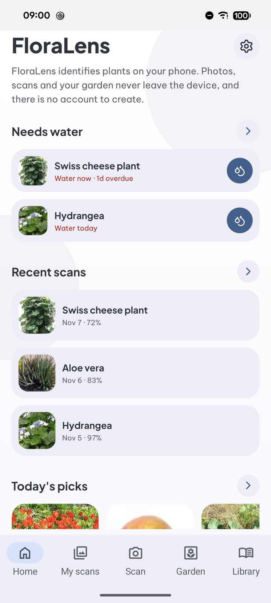
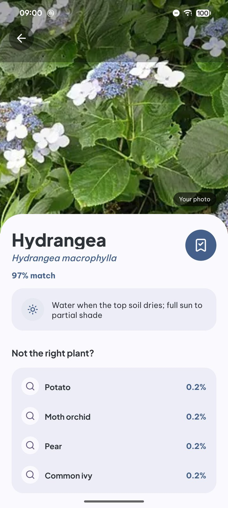

# FloraLens

FloraLens is an Android app that identifies garden and house plants, checks
leaves for insects, and keeps watering reminders on the phone. The classifiers
run locally with ONNX Runtime, so photos, scans and the garden stay on the
device.

<table><tr>
<td align="center"></td>
<td align="center"><video src="https://github.com/user-attachments/assets/7717cbac-3df7-45a6-aea6-779f5f951564" controls muted playsinline poster="docs/demo/garden.jpg"></video></td>
<td align="center"></td>
</tr></table>

## What it does

- Identifies 118 garden, houseplant, herb, fruit and vegetable species from a
  photo, shows the top five candidates, and flags the result as not sure when the
  best match is below 50%.
- Rejects frames with no plant before classifying, so a laptop screen or a wall
  does not turn into a confident cabbage.
- Checks the same photo for 22 garden insects plus a `no_insect` class, and
  reports beneficial insects as beneficial.
- Saves scans to an on-device history and a garden, with a month calendar of
  watering days, per-plant intervals and a 09:00 local reminder.
- On Android 14 and newer, the photo permission offers **Selected photos**.
  The in-app gallery lists only the photos the user allowed.

## Run it

The Android app needs Node, a JDK, the Android SDK, and a device or emulator:

```bash
git clone https://github.com/abderrahmenex86/FloraLens
cd FloraLens
npm install
npx expo prebuild --platform android
npx expo run:android
```

`npm install` runs two patches needed by ONNX Runtime and NativeWind on Expo
SDK 58. The model files are not committed, so copy them into `assets/models/`
before scanning:

```text
assets/models/plant_gate.onnx    5.9 MB
assets/models/plant_model.onnx  10.6 MB
assets/models/insect_model.onnx 19.0 MB
```

They come from `ml/exports/plant_gate/plant_gate.onnx`,
`ml/exports/garden/model.onnx` and `ml/exports/insects/model.onnx`. Without them
the UI loads but analysis fails.

Release build for an arm64 phone:

```bash
cd android
./gradlew assembleRelease -PreactNativeArchitectures=arm64-v8a \
  --no-parallel --max-workers=2 \
  -Dorg.gradle.jvmargs="-Xmx3g -XX:MaxMetaspaceSize=1g"
```

The current arm64 APK is 116 MB. It is signed with the debug keystore, so
replace that before publishing.

### Machine learning pipeline

Python 3.11 or 3.12 and [uv](https://docs.astral.sh/uv/):

```bash
uv sync --project ml --extra train --extra eval --extra dedupe --extra dev
uv run --project ml pytest -q ml/tests
uv run --project ml floralens --help
```

Datasets live outside git under `data/` and `ml/data/`. `ml/README.md` covers
the manifest, clean, select, split and train commands. `docs/model-screen.md`
records the datasets, the architecture screen and the final test scores. The
app has no unit test suite; `npx tsc --noEmit` and `npm run lint` are its
checks.

## How it works

A scan runs through four stages:

1. The camera or gallery image is resized to 224 and 128 pixels.
2. A pixel gate rejects dark, blank and flat frames before any model runs.
3. A two-class presence gate rejects the frame when `P(not_plant) >= 0.85`.
4. The garden classifier and the insect classifier run in parallel. The result
   screen shows the top five plants, the care note, and an insect treatment when
   the insect score clears 0.7.

The plant model is a 118-class MobileNetV4-Conv-S. The insect model is a
23-class RepViT-M1. Both take 224x224 ImageNet-normalised input. The gate is a
MobileNetV3-Small at 128x128. Class ids and model contracts live in `shared/`;
`tools/validate_contracts.py` checks an export against its class list.

Scans and garden entries are stored in MMKV, with scan photos copied into
private app storage. Watering dates are calendar days. Reminders are rebuilt at
app start, when the app returns to the foreground, after watering and after
garden edits. There is no account and no backend.

## Models

| Model | Classes | Input | top-1 | top-5 | macro-F1 | Size |
|---|---|---|---|---|---|---|
| Plant gate (MNV3-S) | 2 | 128 | 96.5% | n/a | 0.956 | 5.9 MB |
| Garden (MNV4-S) | 118 | 224 | 67.9% | 87.7% | 0.670 | 10.6 MB |
| Insects (RepViT-M1) | 23 | 224 | 83.1% | 96.0% | 0.736 | 19.0 MB |

All scores are on held-out test splits from the 12-hour RTX 5070 training run
recorded in `docs/model-screen.md`. The garden set came from 20,268 GBIF photos
and 106,000 Pl@ntNet-300K images used for class screening. The insect set has
6,311 GBIF photos,
with 3,000 clean leaf photos supplying `no_insect`. A 1,023-class broad model
reached 68.0% top-1 but only 0.431 macro-F1, so it stays a training artifact.

The app ships FP32 models. INT8 dropped the gate's plant recall from 99% to 8%,
so quantization was not used for this release.

## Limits

- Android is the supported target. The ONNX and MMKV native setup has not been
  exercised on iOS.
- Coverage is 118 garden species. Unknown plants still return a top-five guess,
  and fruit close-ups or other non-leaf photos can fall outside the training
  distribution.
- There is no disease classifier. Leaf damage is reported only through the
  insect check.
- The APK carries about 36 MB of models, its largest single asset group.

## Stack

React Native 0.88 · Expo SDK 58 · TypeScript 6 · Expo Router · NativeWind ·
MMKV · ONNX Runtime · PyTorch and timm · ONNX

## Docs

- `docs/model-screen.md` for datasets, the architecture screen, scores and
  exports.
- `docs/input-gate.md` for the pixel and presence gates.
- `docs/watering.md` for schedules, the calendar and reminders.
- `docs/photo-access.md` for the scoped gallery and its permissions.
- `docs/plant-library.md` for covers and the optional full-resolution pack.
- `docs/release-build.md` for the Android build and manifest notes.

The repository has no licence file yet.
