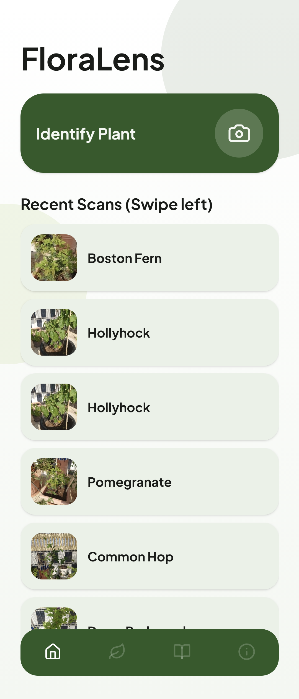
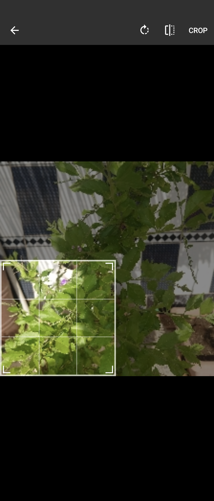
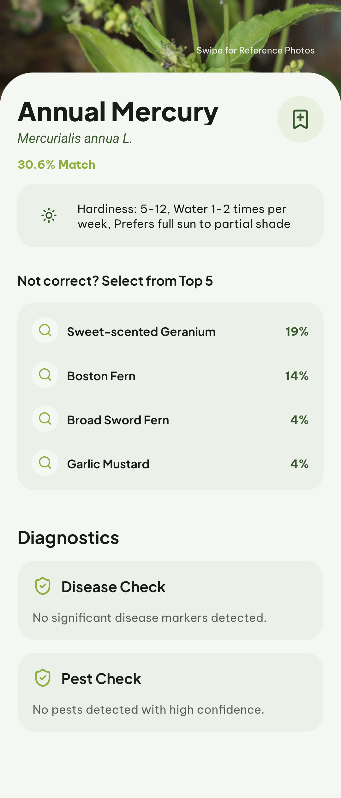
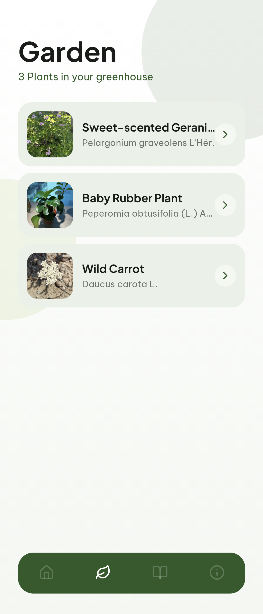

# FloraLens

An Android app that identifies garden and house plants, checks leaves for
insects, and keeps watering reminders, with the models running on the device.
No server, no API calls, no uploaded photos.

   

## What it does

- Runs two ONNX models through `onnxruntime-react-native`, so inference happens
  on the phone with no network round trip.
- Identifies the plant species from a 224x224 photo and degrades to a top-5 list
  when confidence is low.
- Classifies 22 garden insects plus a `no_insect` class, so a healthy leaf is
  not confidently labelled as a pest. Beneficial insects are reported as such.
- Keeps a personal garden and scan history in MMKV, so a scan is available
  offline after the app closes.

## Run it

```bash
git clone https://github.com/abderrahmenex86/FloraLens
cd FloraLens
npm install
```

Put the `.onnx` models in `assets/models/`. The two expected files are
`plant_model.onnx` (118 garden species) and `insect_model.onnx` (23 classes).
Both are gitignored; the export scripts live in `ml/`.

Build a development client, not Expo Go, because the ONNX and MMKV modules
include native code:

```bash
npx expo prebuild --clean --platform android
npx expo run:android
```

Node 18+ and either an Android emulator or a device with USB debugging on.

## How it works

Each scan loads the image, applies the same resize, centre-crop, and normalise
steps the models were trained with, and runs inference on the native thread.
Both classifiers return probabilities; the result screen shows the plant top-5
and the insect match only when it clears the confidence threshold.

Training and ONNX export scripts live in `ml/`.

## Limits

- Android only. The native modules are not configured for iOS.
- The models are shipped as assets, so the APK carries their full size.
- Species coverage is the 118 garden/houseplant/vegetable classes the plant
  model was trained on; an unknown plant still returns a top-5 guess.
- There is no disease classifier: leaf damage is reported only through the
  insect check.

## Stack

React Native · Expo SDK 58 · Expo Router · NativeWind · MMKV · ONNX Runtime

## Related

- [Flora](https://github.com/abderrahmenex86/Plant-Species-Classifier) for the plant classifier
- Plant covers: Wikipedia and Wikimedia Commons contributors (mostly CC BY-SA)
- Training data: [GBIF](https://www.gbif.org) and [Pl@ntNet-300K](https://doi.org/10.23708/LXGXQK)
